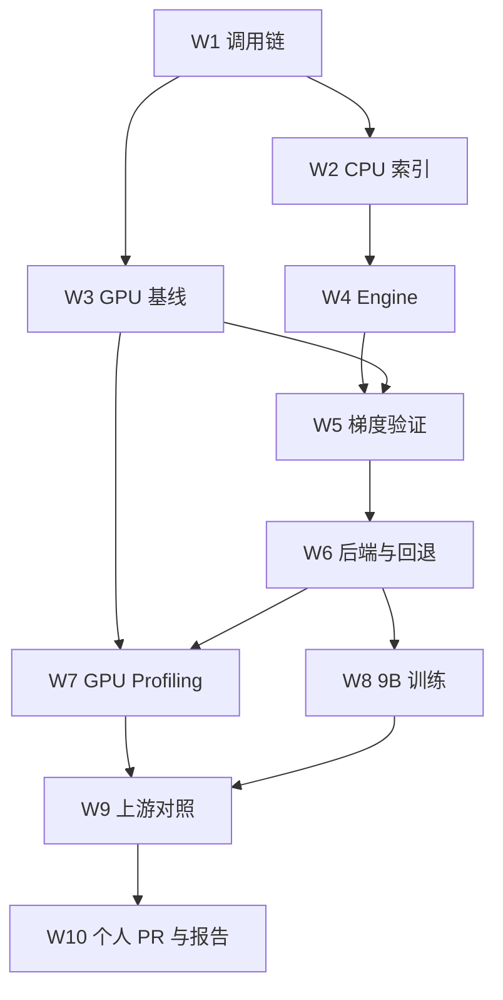

# 十周研究计划 · verl #8649

目标是在 70 小时内独立走通一次真实 PR 研发。每周约 7 小时，每晚约 1 小时。W2、W3 可独立推进，W7、W8 共享 W6 验收后的候选。等待 GPU 时可切换到就绪的 CPU 节点，实际超出预算时记录原因并顺延。

[上游问题](https://github.com/verl-project/verl/issues/8649) · [Tracking Issue](https://github.com/zincsabian/verl/issues/1) · [可勾选任务](TODO.md)

## 依赖图

| 周次 | 研究问题与主要工作 | 前置 | 交付 |
| --- | --- | --- | --- |
| W1 | **固定 FSDP2 → fused output → PPO/GRPO loss 的调用链**。在固定 SHA 上从 actor update 找到 engine、model、head 和 loss consumer，逐处记录 symbol 与输入输出。 用两条变长序列手算 next-token 对齐，列出 entropy、mask、SFT、distill、SP 的消费方。 | 建档 | DESIGN.md |
| W2 | **构造 packed response index 的 CPU oracle**。用逐样本 padded+mask 循环作独立参考；记录目标 token、预测行和样本归属。 覆盖左右 padding、1-token response、混合长度、空有效响应、多轮 mask 孔洞和相邻样本边界。 | W1 | CPU tests、测试命令和结果 |
| W3 | **测量全量 LM head 前反向基线**。固定 seed、H/V、后端、dtype 和总 packed token 数，保存一份可重复生成的合成输入。 预热后分开测 forward、backward、组合和 peak memory；输出原始逐次计时。 | W1 | Baseline Run ID |
| W4 | **由 engine 构建并传递选择索引**。从 W1 的消费方反推启用条件；在 packing 信息仍可用处生成预测行，沿现有 forward 参数传递。 对禁用、元数据缺失及未支持请求保留 full 路径，并观测实际传入的 index。 | W2 | Engine 修改与测试提交 |
| W5 | **验证选择投影与反向传播**。共享同一 backbone 输出、权重和上游梯度，只选择 LM head 输入行，按原调用者所需恢复结果。 对照 full oracle 的 logprob、entropy、loss、dH、dW，按 dtype 预先设定阈值；记录最大误差位置。 | W3、W4 | Correctness Report / Run ID |
| W6 | **检查后端与回退回归**。核实 Torch/Triton 各自支持的模式和 backward；在相同数据上比较支持路径。 构造 SFT、distillation、sequence parallel、需全量 logits 等用例；明确支持、回退或待测。 | W5 | PR candidate、回归矩阵 |
| W7 | **解释 GPU 收益及其上限**。固定 T/H/V，对 selected rows/T 做 10%、25%、50%、90%、近全量扫描，计入 gather/scatter。 用 Nsight Systems 看时间线和 launch 数，用 Nsight Compute 看代表 kernel 的计算、带宽或占用。 | W3、W6 | Benchmark Report、.nsys-rep、.ncu-rep |
| W8 | **在正式模型上验证训练**。固定 Qwen3.5-9B revision、FSDP2 拓扑、rollout 配置和数据；先用同一 rollout batch 做 actor A/B。 跑 vLLM rollout → logprob → loss → backward → optimizer step；区分 actor update 与整轮耗时。 | W6 | E2E Training Report / Run ID |
| W9 | **在独立实现冻结后对比 #8760**。记录独立实现 SHA，再读取 #8760 的 diff、review、测试及版本。 逐项比较索引语义、接口、后端、回退、测试和性能；能对齐硬件/配置时再跑直接 A/B。 | W7、W8 | Fork PR Draft、对照表 |
| W10 | **完成个人 Fork PR、自审与总结**。明确 PR 的 base/head 都在个人 Fork；逐行审查并在固定 head SHA 重跑测试，查看 CI。 汇总训练验证、正负结果、局限、复现步骤和后续可独立贡献的缺口。 | W9 | Final Research Report、个人 PR |

## 设备和时间安排

| 阶段 | 资源与保留方式 |
| --- | --- |
| W1–W2、文档与审查 | 本地 CPU 完成源码追踪和小张量 oracle。只需模型形状时读取 config。 |
| W3、W5–W7 | 先选可容纳目标 shape 的单卡 4090/5090；同一组 A/B 锁定同一型号。需要 Blackwell 专项时另记一组。 |
| W8 | 按 9B 参数、梯度、优化器、激活、rollout KV 与并置方式做容量预算，再按需选 A800/H20 等大显存卡与数量。记录互联和通信拓扑。4B 可排查环境。 |
| 停机前 | 把代码提交、环境锁文件/镜像版本、模型 revision 和缓存、原始日志与 profiler 报告写入持久卷；复开时从同一位置恢复，先执行 smoke。 |

## 验收口径

小张量负责定位语义错误，微基准回答 head 的收益，9B 训练回答收益能否传递到 actor。允许零收益或退化，只要能复现并解释限制。独立实现冻结前保留自己的设计与实验记录；W9 才比较 [#8760](https://github.com/verl-project/verl/pull/8760) 的代码。W10 在 Fork 内开个人 PR，只有确认存在独立增量才另议上游投稿。
